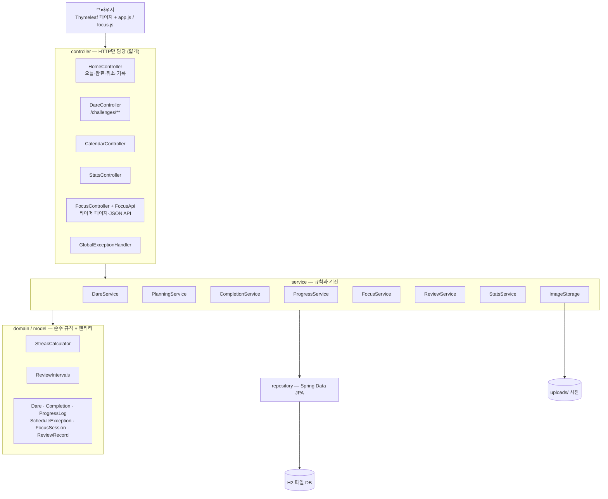
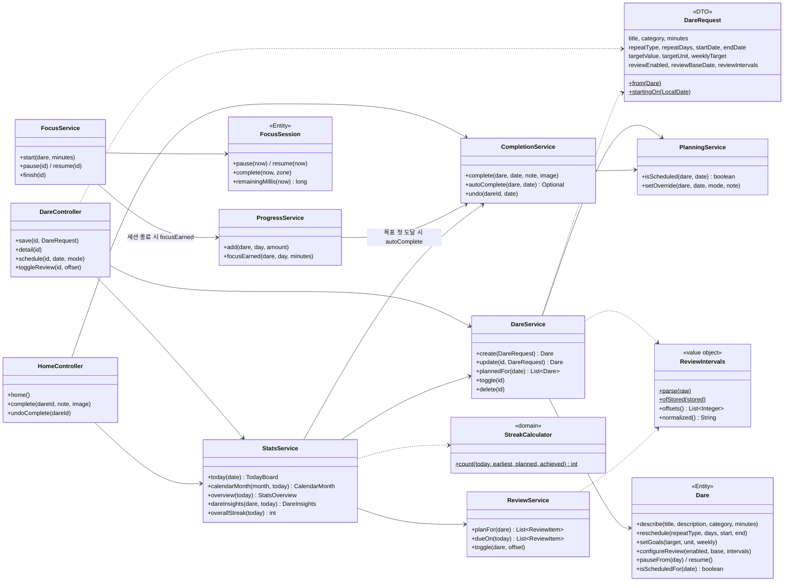
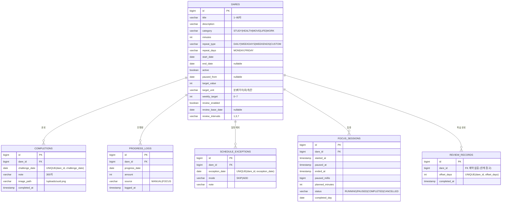
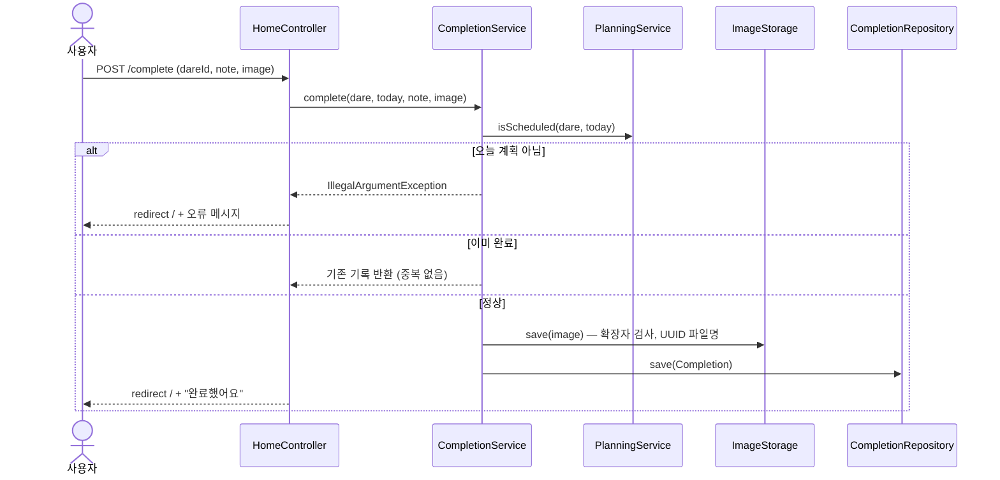
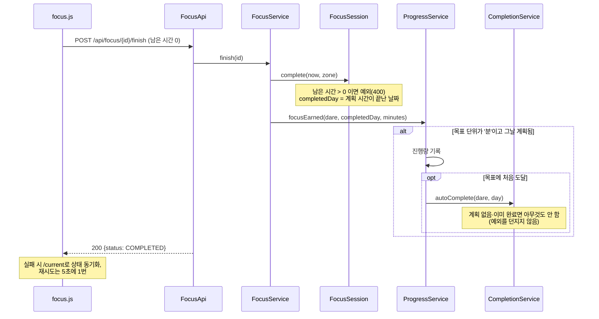
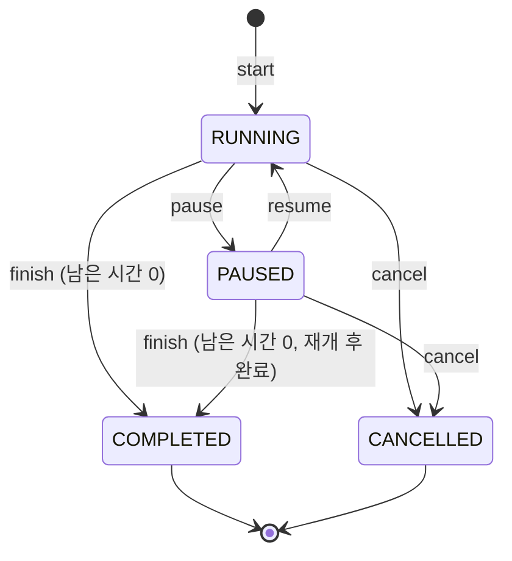

# DaySpark 설계

GitHub에서 이 파일을 열면 Mermaid 다이어그램이 그림으로 보입니다.
보고서(Word)에 넣을 때는 [mermaid.live](https://mermaid.live)에 코드 블록을 붙여 PNG/SVG로 내보내세요.

## 1. 계층 구조

- **Controller**는 요청 파라미터를 받고 서비스 결과를 모델에 담기만 합니다. 계산 로직이 없습니다.
- **StatsService**가 오늘 화면·달력·통계·도전 상세의 숫자를 모두 만들기 때문에 화면끼리 숫자가 어긋나지 않습니다.
- **domain** 패키지(`StreakCalculator`, `ReviewIntervals`, enum들)는 Spring·DB 없이 단위 테스트합니다.
- 모든 날짜·시간은 주입된 `Clock`에서 가져옵니다(테스트에서 고정 가능).

## 2. 주요 클래스

### 설계 결정

| 결정 | 이유 |
|---|---|
| 폼 전체를 `DareRequest` DTO 하나로 받고 `create(request)` / `update(id, request)` 두 메서드만 둠 | 기능이 늘 때마다 `createWithGoals…` 같은 메서드와 파라미터(최대 16개)가 늘던 구조를 끊기 위해 |
| `Dare`의 변경은 `describe / reschedule / setGoals / configureReview` 네 메서드로 | 의미 단위로 묶어 파라미터를 4개 이하로 유지 |
| 하루의 계획 = 예정된 도전 + 그날 완료한 도전 (`DareService.plannedFor`) | 규칙 변경 후 달성률 200% 같은 모순을 원천 차단. 모든 화면이 같은 메서드를 씀 |
| Streak 규칙을 `StreakCalculator` 순수 함수로 | 전체/도전별 두 곳의 루프가 서로 다른 조건을 쓰던 문제 제거, Spring 없이 테스트 |
| 복습 간격 파싱을 `ReviewIntervals` 값 객체로 | 두 서비스에 복붙돼 있던 파싱 코드를 하나로 |
| 자동 완료(`autoComplete`)는 예외를 던지지 않음 | 집중 세션 종료(finish)가 목표 처리 때문에 실패하면 세션이 RUNNING으로 남고 브라우저가 재시도 폭주 |
| 사진 저장·삭제를 `ImageStorage` 하나로 | 완료·완료 취소·도전 삭제가 같은 경로 검증 로직을 씀 |
| 내비게이션 바를 Thymeleaf fragment(`fragments/layout.html`)로 | 9개 템플릿에 복붙돼 서로 달라지던 문제 제거 |

## 3. 데이터 모델 (ERD)

JPA 엔티티에서 생성되는 실제 테이블 기준입니다(`spring.jpa.hibernate.ddl-auto=update`).

- 복습 **예정일은 저장하지 않습니다.** `review_base_date + offset_days`로 계산하고, 완료한 회차만 `review_records`에 남깁니다.
- 하루의 계획도 저장하지 않고 반복 규칙 + 예외 + 완료 기록으로 계산합니다.

## 4. 주요 흐름

### 4.1 오늘의 도전 완료

### 4.2 집중 세션 종료 → 진행량 → 자동 완료

### 4.3 집중 세션 상태

- 동시에 진행 중인 세션은 1개뿐입니다(`FocusService.start`).
- 서버가 시작 시각·누적 일시정지 시간을 저장하므로 새로고침이나 탭을 닫아도 세션이 유지됩니다.
