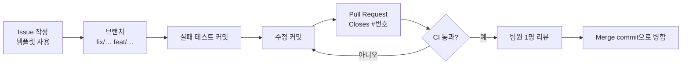

# 개발 과정: Git · Issue · PR · CI

## 1. 개발 이력과 현재 구성

버전별 기능 변경 사항은 [CHANGELOG.md](CHANGELOG.md), 현재 테스트 구성은 [testing.md](testing.md)를 참고합니다.
프로젝트는 Java 17, Maven Wrapper, Spring Boot와 H2 파일 데이터베이스를 사용합니다.
현재 저장소의 자동화 테스트는 도메인 단위테스트 4개 클래스(25개 메서드)입니다.

주요 변경 흐름:

| 영역 | 내용 |
|---|---|
| 실행 환경 | Java 17 기준, `RUN_DAYSPARK.bat`, Maven Wrapper |
| 도메인 규칙 | `StreakCalculator`, `ReviewIntervals`, 날짜별 일정 처리 |
| 기능 | 복습 플랜, 포모도로 기록, 중간 종료, 도전 전환 |
| 구조 | 입력 DTO와 Controller/Service/Repository 분리, 화면용 DTO 정리 |
| 품질 관리 | JUnit 5 단위테스트, JaCoCo, GitHub Actions |

## 2. GitHub에 올리기 (최초 1회)

```bash
# 1) GitHub에서 빈 저장소 DaySpark 생성 (README 추가 체크 해제)
# 2) WSL에서
cd DaySpark
git remote add origin https://github.com/<계정>/DaySpark.git
git push -u origin main
```

그다음 GitHub 설정:

1. **Actions** 탭에서 첫 CI 실행 결과 확인 → [testing.md](testing.md)의 실행 방법에 따라 기록 확인
2. **Settings → Branches → Add rule** `main`: "Require a pull request before merging",
   "Require status checks to pass" (CI의 `Build and test (JDK 17)`, `(JDK 25)`) 체크
3. **Settings → Collaborators**에 팀원 추가
4. README 상단에 배지(선택):
   ``

## 3. 앞으로의 작업 방식



| 규칙 | 내용 |
|---|---|
| 이슈 | 모든 작업은 이슈부터. 템플릿: `.github/ISSUE_TEMPLATE/` (버그 / 기능) |
| 브랜치 이름 | `fix/…`, `feat/…`, `refactor/…`, `test/…`, `docs/…`, `build/…` |
| 커밋 메시지 | `type: 무엇을 왜` (Conventional Commits). 예: `fix: reject SKIP and RESET on a date that is already completed` |
| 버그 수정 | **실패 테스트 커밋 → 수정 커밋** 순서 (PR 안에서) |
| PR | 템플릿(`.github/pull_request_template.md`) 체크리스트, 본문에 `Closes #이슈번호` |
| 병합 | CI 녹색 + 리뷰 1명 승인 후 **Create a merge commit** (Squash 금지: 테스트 → 수정 순서가 사라짐) |
| 담당 | 이슈에 Assignee 지정. 팀원마다 PR을 나눠 맡아 기여 기록이 남게 |

### 지금 만들면 좋은 이슈 (예시)

- [ ] `./mvnw verify` 로컬 실행 결과와 커버리지를 `testing.md`의 안내에 따라 확인
- [ ] Windows 10/11에서 `RUN_DAYSPARK.bat` 수동 확인 ([testing.md](testing.md)의 수동 확인 항목)
- [ ] 보고서의 테스트 실행 결과를 실제 `verify` 출력과 대조
- [ ] 발표용 화면 캡처 (오늘 / 달력 / 통계 / 집중 타이머 / 복습)
- [ ] CI 결과를 보고 필요하면 서비스 계층 커버리지 기준(`jacoco:check`) 추가 검토

## 4. CI

`.github/workflows/ci.yml` — `main` push와 모든 PR에서 실행.

| 단계 | 내용 |
|---|---|
| JDK | 17(프로젝트 기준), 25(팀 Windows PC) 두 버전 동시 |
| 빌드 | `./mvnw -B -ntp verify` (컴파일 → 단위테스트 25개 → JaCoCo) |
| 결과 | JDK 17 실행 요약에 패키지별 커버리지 표, `jacoco-report`·`surefire-reports-*` 아티팩트 업로드 |
