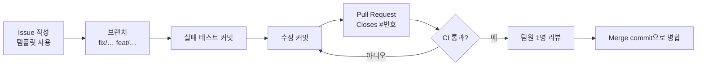

# 개발 과정: Git · Issue · PR · CI

## 1. 지금까지의 이력

버전 관리는 v5.5 시점에 시작했습니다. 그 이전(v1~v5.5)의 변경은 [CHANGELOG.md](CHANGELOG.md)에만 있고,
**과거 날짜로 꾸민 커밋은 없습니다.** 첫 커밋 `48f5160`이 v5.5 원본 그대로입니다.

```bash
git log --oneline --graph      # 브랜치와 병합 구조 보기
```

| 단계 | 브랜치 / 커밋 | 내용 |
|---|---|---|
| 기준선 | `48f5160` | v5.5 그대로 + `.gitattributes` |
| 환경 | `9fa1b23`, `b5f4527` | Java 17 기준 통일, 실행기를 `RUN_DAYSPARK.bat` 하나로 |
| 테스트 정비 | `c5741f4`, `0cafdff`, `7fa6966`, `de147d1` | 항상 실패/항상 통과하던 테스트 수정, 고정 시계, `now()` 제거 |
| 버그 수정 | `fix/stats-rate-over-100`, `fix/reset-after-completion`, `fix/overdue-reviews`, `feat/undo-completion` | 브랜치마다 **실패 테스트 → 수정** 2커밋 후 병합 |
| 규칙 고정 | `rules/explicit-domain-rules` | `StreakCalculator`, `domain-rules.md`, `DomainRuleTests` |
| 기능 연결 | `feat/focus-auto-complete` | 포모도로 → 진행량 → 자동 완료, 브라우저 재시도 폭주 수정 |
| 버그 | `fix/category-options` | MIND 카테고리 |
| 구조 | `refactor/structure` | DTO, `ReviewIntervals`, `StatsService`, 컨트롤러 분리, 오류 처리, fragment, 포맷 |
| 빌드 | `build/jacoco-ci` | JaCoCo, GitHub Actions |
| 문서 | `docs/design-and-process` | 요구사항·설계·테스트·과정·한계 문서 |

이 이력은 로컬에서 만든 뒤 GitHub에 한 번에 올린 것입니다. 그래서 위 브랜치들에는 GitHub의 PR·리뷰 기록이 없습니다.
**GitHub의 Issue / PR / CI 기록은 저장소를 올린 다음부터 쌓입니다** (아래 3절).

일부 커밋은 AI 도구(Claude)와 함께 작성했고, 해당 커밋 메시지 끝에 `Co-Authored-By: Claude` 표기가 있습니다.

## 2. GitHub에 올리기 (최초 1회)

```bash
# 1) GitHub에서 빈 저장소 DaySpark 생성 (README 추가 체크 해제)
# 2) WSL에서
cd DaySpark
git remote add origin https://github.com/<계정>/DaySpark.git
git push -u origin main

# 3) Maven Wrapper가 아직 없다면 (README "Maven Wrapper")
mvn -N wrapper:wrapper -Dmaven=3.9.11 -Dtype=only-script
chmod +x mvnw
git add mvnw mvnw.cmd .mvn
git commit -m "build: add Maven Wrapper"
git push
```

그다음 GitHub 설정:

1. **Actions** 탭에서 첫 CI 실행 결과 확인 → [testing.md](testing.md) 4.1 표에 기록
2. **Settings → Branches → Add rule** `main`: "Require a pull request before merging",
   "Require status checks to pass" (CI의 `Build and test (JDK 17)`, `(JDK 25)`) 체크
3. **Settings → Collaborators**에 팀원 추가
4. README 상단에 배지(선택):
   ``

## 3. 앞으로의 작업 방식



| 규칙 | 내용 |
|---|---|
| 이슈 | 모든 작업은 이슈부터. 템플릿: `.github/ISSUE_TEMPLATE/` (버그 / 기능) |
| 브랜치 이름 | `fix/…`, `feat/…`, `refactor/…`, `test/…`, `docs/…`, `build/…` |
| 커밋 메시지 | `type: 무엇을 왜` (Conventional Commits). 예: `fix: reject SKIP and RESET on a date that is already completed` |
| 버그 수정 | **실패 테스트 커밋 → 수정 커밋** 순서 (PR 안에서) |
| PR | 템플릿(`.github/pull_request_template.md`) 체크리스트, 본문에 `Closes #이슈번호` |
| 병합 | CI 녹색 + 리뷰 1명 승인 후 **Create a merge commit** (Squash 금지: 테스트 → 수정 순서가 사라짐) |
| 담당 | 이슈에 Assignee 지정. 팀원마다 PR을 나눠 맡아 기여 기록이 남게 |

### 지금 만들면 좋은 이슈 (예시)

- [ ] `./mvnw verify` 로컬 실행 결과와 커버리지를 `testing.md` 4.1에 기록
- [ ] Windows 10/11에서 `RUN_DAYSPARK.bat` 수동 확인 (`testing.md` 5절)
- [ ] 보고서 docx의 `[작성 필요]` 채우기 (요구사항·설계·테스트 결과·화면 캡처)
- [ ] 발표용 화면 캡처 (오늘 / 달력 / 통계 / 집중 타이머 / 복습)
- [ ] CI 결과를 보고 필요하면 서비스 계층 커버리지 기준(`jacoco:check`) 추가 검토

## 4. CI

`.github/workflows/ci.yml` — `main` push와 모든 PR에서 실행.

| 단계 | 내용 |
|---|---|
| JDK | 17(프로젝트 기준), 25(팀 Windows PC) 두 버전 동시 |
| 빌드 | `./mvnw -B -ntp verify` (컴파일 → 테스트 54개 → JaCoCo) |
| 결과 | JDK 17 실행 요약에 패키지별 커버리지 표, `jacoco-report`·`surefire-reports-*` 아티팩트 업로드 |
